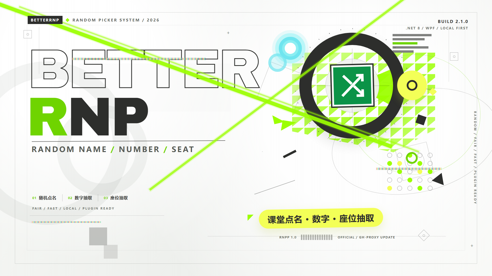

# BetterRNP



**BetterRNP 是一款面向课堂、会议和活动现场的 Windows 随机抽取工具。**

它把随机点名、随机数字和随机座位集中在一个轻量桌面程序中：不用准备表格公式，也不用临时写脚本，选择方案和模式后即可开始滚动抽取。程序支持常驻系统托盘、悬浮球快速抽取、加密本地存储、可配置的照片背景，以及 `.rnpp` 插件扩展。

- 当前版本：**BetterRNP 2.3.3**
- 运行环境：**Windows 10 / 11 64 位**

## 为什么选择 BetterRNP

- **抽取过程直观**：点击开始后结果快速滚动，再点一次停止定格，比直接弹出结果更有现场氛围。
- **一套程序覆盖三种场景**：随机点名、随机数字、随机座位共用同一套方案与交互。
- **现场操作方便**：主窗口可隐藏到托盘，悬浮球可置顶显示，双击即可快速抽取。
- **六种界面语言**：支持简体中文、繁體中文、繁體中文（粵語）、English、Русский 和日本語，设置中可即时切换。
- **演示时保持焦点**：悬浮球不会从全屏视频抢焦点；抽取结束后会自动把键盘焦点还给 PPT 放映窗口，翻页笔可以继续翻页。
- **数据保存在本地**：名单、数字范围和座位配置加密存储，并自动维护多份备份。
- **可按需扩展**：通过 `.rnpp` 插件增加菜单命令或自定义抽取模式。
- **主题可定制**：支持导入图片、按窗口指定背景、遮罩和自由裁切。

## 三种抽取模式

| 模式 | 用途 | 说明 |
|---|---|---|
| 名字列表模式 | 课堂点名、活动抽人 | 从当前方案名单中随机选择姓名 |
| 数字模式 | 抽取号码、积分或题号 | 支持负数、单值范围和自定义区间 |
| 座位模式 | 随机选择座位 | 从座位图中已选座位里抽取，最多 30 × 30 布局 |

所有模式都支持滚停式抽取：结果按 50ms 间隔轮换，点击“停止”后保留最终结果，并写入操作日志。

## 主要功能

### 方案与名单

- 为不同班级、活动或课程创建独立方案。
- 方案类型包括名单、数字和座位。
- 名单支持手动添加、删除、TXT 导入与 TXT 导出。
- 数字范围和座位布局采用显式保存，关闭前会提示未保存修改。
- 启动时自动恢复上次使用的方案。

### 现场抽取体验

- 主窗口提供大字号结果区，适合投影和课堂展示。
- 系统托盘提供显示/隐藏主窗口、悬浮球和退出入口。
- 托盘右键菜单使用 Windows 原生 Win32 菜单。
- 悬浮球支持置顶、拖动、双击随机抽取和右键快捷设置。
- 重复启动程序时会唤醒已有窗口，不会产生多个实例。
- 结果抽取后自动记录到本地日志。

### 背景主题

- 从本地导入 PNG、JPG、BMP、GIF、TIFF 等图片。
- 图片库带缩略图预览。
- 支持全局背景和按窗口类别单独指定。
- 支持填充、适应、拉伸、居中和自由裁切。
- 可调整背景遮罩，兼顾视觉效果和文字可读性。

### 插件扩展

- 插件包使用 `.rnpp` 扩展名。
- 插件管理窗口支持加载、移除、启用和禁用插件。
- 插件可以向主窗口“插件”菜单添加命令。
- 插件可以向悬浮球右键菜单添加命令。
- 插件可以注册新的抽取模式。
- 插件状态自动保存，禁用后其界面入口立即隐藏。
- 提供独立插件 SDK，构建插件时自动生成 `.rnpp` 包。

插件开发请参阅 [插件开发文档](docs/PLUGIN_SDK.md)。

### 检查更新

- 启动时自动检查 GitHub Releases，也可手动检查。
- 支持官方源和 `gh-proxy` 国内加速镜像源。
- 自动识别当前安装是自包含版还是框架依赖版。
- 更新时默认选择对应安装包，也可手动切换。
- 下载完成后自动覆盖程序目录并重启。

### 操作日志

- 程序会把启动、抽取、方案与名单修改、设置调整、主题、更新、插件和异常等操作全部写入 `log/Modifylog.txt`。
- 每条记录包含毫秒级时间、级别（信息 / 警告 / 错误）、操作名和详细参数，例如 `方案=初三1班｜模式=名字列表模式｜结果=张三`。
- 日志超过 1 MB 自动滚动，保留 5 份历史文件（`Modifylog.1.txt` 为最近一份）。
- “帮助 → 查看日志…”或“设置 → 查看日志”可打开日志查看器：按级别筛选、关键字搜索、自动刷新、打开日志目录、导出和清空。
- 完整的操作清单见 [日志说明](docs/LOGGING.md)。

### 数据与安全

- 名单、数字范围和座位配置使用 AES-GCM 加密。
- 每个数据文件都带 SHA-256 完整性校验。
- 数据同时保存在主目录、备份目录和日志目录，损坏时自动恢复。
- 配置可锁定，防止现场误改名单或方案。
- 密码散列使用 PBKDF2-HMAC-SHA256，并兼容旧版密码格式。
- 用户设置统一保存在当前用户注册表，名单、方案和主题图片保存在本地程序目录，不依赖云端账号。

#### 可选密码

BetterRNP 默认不设置密码，首次启动时配置保持解锁状态。如需防止名单、方案或设置被
误改，可进入“设置 → 安全”，点击“设置密码”自行配置密码。设置密码后，修改受保护
设置前需要先完成鉴权。

已设置密码的用户可在同一页面点击“删除密码”，完成鉴权并确认后停用密码保护。
删除密码会同时关闭备用解锁通道。

未设置密码时，主界面会用红色小字提示名单和方案可能被未经授权修改。旧版本遗留的
内置默认密码会在升级后自动移除。

#### 可选备用解锁通道

`Ctrl+L` 备用解锁通道默认关闭。设置密码并完成鉴权后，可在“设置 → 安全”中选择是否
启用。启用后，如果在密码窗口中忘记密码，可在每次按键间隔不超过 2 秒的情况下连续
按 `Ctrl+L` 10 次恢复访问，并写入警告日志。

该通道会降低密码保护强度，请只在能够接受本机恢复风险时启用。

## 下载与安装

前往 [GitHub Releases](https://github.com/TakaHoshino/BetterRandomNamePicker/releases/latest) 下载最新版本。

Release 同时提供两种应用包：

| 版本 | 适用情况 | 特点 |
|---|---|---|
| 自包含版 | 推荐 | 已内置 .NET 8 运行时，解压即用 |
| 框架依赖版 | 已安装 .NET 8 Desktop Runtime | 体积更小，需要系统运行时 |

下载后解压到任意可写目录，运行 `BetterRNP.exe` 即可。

> 正式公开构建应使用受信任的代码签名证书。未签名版本在 Windows 上可能显示“未知发布者”或 SmartScreen 提示。签名配置见 [代码签名文档](docs/CODE_SIGNING.md)。

插件开发者还可以下载：

- `BetterRNP.PluginSdk.1.4.0.nupkg`

## 快速上手

1. 启动 BetterRNP，从顶部选择预设方案。
2. 选择名字列表、数字或座位模式。
3. 点击“开始抽取”，结果会快速滚动。
4. 再次点击“停止”，结果定格并写入日志。
5. 如需修改数据，进入“配置名单”或对应模式设置窗口。
6. 可从“设置”中启用托盘、悬浮球、背景主题和自动检查更新。

## 数据位置

应用设置统一保存在：

```text
HKEY_CURRENT_USER\Software\BetterRNP\Settings
```

其中包含常规、悬浮球、安全、更新、插件和主题设置。升级或移动程序目录不会丢失这些设置。

程序默认在当前目录下创建：

```text
data/      方案、加密名单、备份和主题图片
log/       操作日志与加密备份
plugins/   .rnpp 插件
```

升级程序时不会覆盖已有 `data/` 和 `plugins/` 内容。旧版
`config.properties`、`theme.properties`、`update.json` 和 `plugins.json`
会在首次启动时自动迁移到注册表，成功后删除旧设置文件。

旧版 Java 版本保存的加密名单、数字和座位数据可以继续读取。旧 Java 插件 jar 不再兼容，请使用新的 `.rnpp` 插件。

## 技术栈

- .NET 8
- C# / WPF
- Win32 托盘 API
- AES-GCM + PBKDF2
- GitHub Releases 更新机制

界面采用系统字体、系统颜色和 WPF 默认控件样式，保持接近 Windows 原生对话框的观感。

## 从源码构建

需要 Windows 和 .NET 8 SDK：

```bat
dotnet build BetterRNP.sln -c Release
```

运行：

```bat
dotnet run --project src\BetterRNP\BetterRNP.csproj
```

同时生成自包含版、框架依赖版和插件 SDK：

```powershell
powershell -ExecutionPolicy Bypass -File tools\build-release.ps1
```

## 开发与文档

- [插件开发文档](docs/PLUGIN_SDK.md)
- [代码签名文档](docs/CODE_SIGNING.md)
- [日志说明](docs/LOGGING.md)
- [设置存储说明](docs/SETTINGS_STORAGE.md)
- [项目交接文档](docs/HANDOFF.md)
- [多语言说明](docs/LOCALIZATION.md)
- [BetterRNP v2.3.0 Release Note](docs/releases/v2.3.0.md)
- [BetterRNP v2.3.1 Release Note](docs/releases/v2.3.1.md)
- [BetterRNP v2.3.2 Release Note](docs/releases/v2.3.2.md)
- [BetterRNP v2.3.3 Release Note](docs/releases/v2.3.3.md)
- [BetterRNP v2.2.0 Release Note](docs/releases/v2.2.0.md)
- [BetterRNP v2.1.1 Release Note](docs/releases/v2.1.1.md)
- [BetterRNP v2.1.0 Release Note](docs/releases/v2.1.0.md)
- 插件 SDK：[src/BetterRNP.PluginSdk](src/BetterRNP.PluginSdk)
- 示例插件：[examples/BetterRNP.DemoPlugin](examples/BetterRNP.DemoPlugin)
- 随机性分析插件：[examples/BetterRNP.RandomnessAnalyzerPlugin](examples/BetterRNP.RandomnessAnalyzerPlugin)

生成并信任默认本地开发签名：

```powershell
powershell -ExecutionPolicy Bypass -File tools\create-dev-signing-cert.ps1 -InstallTrust
```

签名流程兼容 Windows PowerShell 5.1 与 PowerShell 7，不要求额外安装 `pwsh`。

如果发布包附带 `BetterRNP-Development-Certificate.cer`，可运行以下命令让当前用户信任该自签名发布证书：

```powershell
powershell -ExecutionPolicy Bypass -File tools\install-release-cert.ps1 -CertificatePath .\BetterRNP-Development-Certificate.cer
```
- 计时插件示例：[examples/BetterRNP.TimerPlugin](examples/BetterRNP.TimerPlugin)

运行核心与界面冒烟测试：

```bat
dotnet run --project tests\BetterRNP.Tests\BetterRNP.Tests.csproj -c Release
```

## 项目定位

BetterRNP 的目标是成为一个简单、快速、可直接在课堂现场使用的随机抽取工具：不需要登录，不依赖网络，不要求复杂配置，同时为有需要的用户保留主题、插件和自动更新等扩展能力。

## 许可证

本项目使用 **Apache License 2.0** 开源，详见 [LICENSE](LICENSE)。

宣传 Banner 中使用的 Archivo Black 字体按其自身 **SIL Open Font License 1.1** 分发，详见 [OFL.txt](assets/banner/fonts/OFL.txt)。
