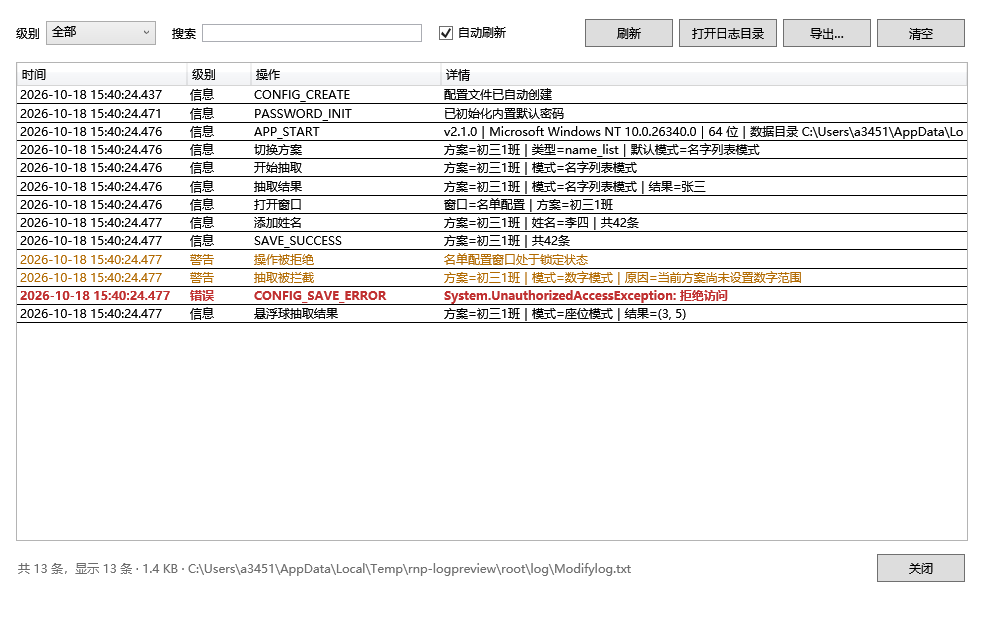

# BetterRNP 日志说明

BetterRNP 会记录启动、抽取、数据修改、设置、主题、更新、插件与异常等全部操作，方便现场排查问题或回溯操作过程。

## 1. 日志文件

| 项目 | 说明 |
|---|---|
| 位置 | `<程序目录>\log\Modifylog.txt`（可用环境变量 `BETTERRNP_HOME` 改变根目录） |
| 编码 | UTF-8（无 BOM） |
| 格式 | `[时间] [级别] 【操作】详情` |
| 时间精度 | 毫秒，例如 `2026-10-18 15:30:12.345` |
| 大小上限 | 1 MB，超出后自动滚动 |
| 历史文件 | `Modifylog.1.txt`～`Modifylog.5.txt`，数字越小越新 |
| 级别 | `INFO`（信息）、`WARN`（警告）、`ERROR`（错误） |

示例：

```text
[2026-10-24 22:00:00.000] [INFO ] 【APP_START】v2.2.0｜Microsoft Windows NT 10.0.26200.0｜64 位｜数据目录 D:\BetterRNP
[2026-10-18 15:30:20.118] [INFO ] 【切换方案】方案=初三1班｜类型=name_list｜默认模式=名字列表模式
[2026-10-18 15:30:24.902] [INFO ] 【开始抽取】方案=初三1班｜模式=名字列表模式
[2026-10-18 15:30:26.377] [INFO ] 【抽取结果】方案=初三1班｜模式=名字列表模式｜结果=张三
[2026-10-18 15:31:02.640] [WARN ] 【操作被拒绝】名单配置窗口处于锁定状态
[2026-10-18 15:31:10.005] [ERROR] 【CONFIG_SAVE_ERROR】保存配置失败: 拒绝访问
```

- 一条记录始终占一行；异常堆栈中的换行会写成 ` ⏎ `，保证日志可被逐行解析。
- 旧版本（`【详情】【操作】` 格式）的日志仍可被查看器读取，级别按“信息”处理。

## 2. 查看与导出



- 主窗口菜单 **帮助 → 查看日志…**；
- 设置窗口 **日志 → 查看日志**；
- 日志查看器支持：级别筛选、关键字搜索、自动刷新、打开日志目录、导出、清空当前日志；
- 设置窗口的“导出日志文件”只复制当前 `Modifylog.txt`。

清空只删除当前文件，历史归档保留。

## 3. 全部操作清单

级别为“信息”的记录是正常操作；警告用于被拒绝或需要留意的操作；错误用于异常和失败。

### 3.1 应用与窗口

| 操作 | 级别 | 记录内容 |
|---|---|---|
| `APP_START` | 信息 | 版本 / 操作系统 / 位数 / 数据目录 |
| `UPDATE_INSTALL_TYPE` | 信息 | 自包含版或框架依赖版 |
| `APP_EXIT` | 信息 | 程序退出 |
| `取消退出` | 信息 | 退出确认中选择“否” |
| `显示主窗口` | 信息 | 主窗口显示（含启动完成、托盘或单实例唤醒） |
| `隐藏主窗口` | 信息 | 主窗口隐藏或最小化到托盘 |
| `BALL_SHOWN` / `BALL_HIDDEN` / `BALL_AUTO_SHOW` | 信息 | 悬浮球显示、隐藏、按设置自动显示 |
| `打开窗口` | 信息 | 窗口名，部分窗口附带当前方案 |
| `UNHANDLED_UI_EXCEPTION` / `UNHANDLED_EXCEPTION` / `UNOBSERVED_TASK_EXCEPTION` | 错误 | 未处理异常的类型、消息与堆栈 |

### 3.2 抽取

| 操作 | 级别 | 记录内容 |
|---|---|---|
| `切换方案` | 信息 | 方案、类型、自动切换到的模式 |
| `切换模式` | 信息 | 模式名称 |
| `开始抽取` | 信息 | 方案、模式（数字/座位模式附范围或候选数） |
| `抽取结果` | 信息 | 方案、模式、最终结果 |
| `抽取被拦截` | 警告 | 方案、模式、被拦截原因 |
| `模式按钮` | 信息 | 模式与按钮文字 |
| `查看数字范围` | 信息 | 方案、范围 |
| `悬浮球抽取结果` | 信息 | 方案、模式、结果 |
| `悬浮球抽取失败` / `悬浮球模式无效` / `悬浮球抽取受阻` | 警告 | 失败原因 |

### 3.3 名单

| 操作 | 级别 | 记录内容 |
|---|---|---|
| `名单配置_切换方案` | 信息 | 方案、名单数量 |
| `添加姓名` | 信息 | 方案、姓名、当前总数 |
| `删除姓名` | 信息 | 方案、被删除的姓名、剩余数量 |
| `SAVE_SUCCESS` | 信息 | 方案、保存后的条数 |
| `导入名单` / `导出名单` | 信息 | 方案、文件名、新增条数（取消时记录“用户取消…”） |
| `IMPORT_ERROR` / `EXPORT_ERROR` / `LOAD_ERROR` | 错误 | 方案与异常消息 |
| `名单损坏` | 警告 | 损坏的方案名 |
| `CORRUPTED_FILES_DELETED` | 警告 | 已删除的损坏副本 |
| `操作被拒绝` | 警告 | 锁定状态下尝试修改名单 |

### 3.4 方案、数字与座位

| 操作 | 级别 | 记录内容 |
|---|---|---|
| `创建方案` | 信息 | 方案名、类型 |
| `删除方案` / `取消删除方案` | 信息 | 方案名 |
| `创建方案被拒绝` / `方案已存在` | 警告 | 名称、类型或拒绝原因 |
| `SCHEME_NAME_COLLISION` | 警告 | 与内置方案重名的自建方案 |
| `SCHEME_INDEX_ERROR` | 错误 | 方案索引读取异常 |
| `SAVE_NUMBER_SUCCESS` | 信息 | 方案、数字范围 |
| `数字范围无效` / `数字范围过大` | 警告 | 输入值或跨度 |
| `应用数字范围到方案` | 信息 | 方案名 |
| `放弃未保存的修改` / `取消关闭数字设置` | 信息 | 方案名 |
| `SAVE_SEAT_SUCCESS` | 信息 | 方案、行列数、已选座位数 |
| `SEAT_OUT_OF_RANGE` | 警告 | 被忽略的越界座位数 |
| `未选择座位，无法抽取` / `取消关闭座位设置` | 警告 / 信息 | 方案名 |
| `应用座位设置到方案` | 信息 | 方案名 |
| `SAVE_WITH_ENCRYPTION` | 信息 | 方案、数据类型 |
| `DATA_RECOVERED_AND_SYNCED` / `RECOVERY_FAILED` | 信息 / 警告 | 数据恢复来源或失败原因 |
| `FILE_DELETED` / `FILE_DELETE_FAILED` | 信息 / 错误 | 文件路径与错误 |
| `CONFIG_CREATE` / `CONFIG_RESTORE` | 信息 | 配置文件创建或从备份恢复 |
| `CONFIG_SAVE_ERROR` / `CONFIG_LOAD_ERROR` | 错误 | 异常消息 |

### 3.5 设置与安全

| 操作 | 级别 | 记录内容 |
|---|---|---|
| `SETTING_CHANGED` | 信息 | 开机自启、托盘、自动悬浮球、照片背景、更新源等开关的新状态 |
| `调整悬浮球外观` | 信息 | 拖动结束后的半径或透明度 |
| `解锁配置` | 信息 | 请求解锁 |
| `PASSWORD_UNLOCK` | 信息 | 密码验证通过 |
| `PASSWORD_FAILED` | 警告 | 密码错误 |
| `PASSWORD_CHANGED` | 信息 | 密码已修改 |
| `密码修改被拒绝` | 警告 | 新密码长度不合法 |
| `PASSWORD_INIT` | 信息 | 初始化内置默认密码 |
| `PASSWORD_LOCK` / `LOCK_CHANGED` | 信息 | 配置锁定 / 解锁 |
| `PASSWORD_BACKDOOR` | 警告 | Ctrl+L 备用解锁通道 |
| `SECURITY_UPGRADE` | 信息 | 密码散列升级为 PBKDF2 |
| `操作被拒绝` | 警告 | 锁定状态下尝试改密或修改配置 |

### 3.6 背景主题

| 操作 | 级别 | 记录内容 |
|---|---|---|
| `设置照片背景` | 信息 | 启用 / 停用 |
| `THEME_IMPORT` / `导入主题图片` | 信息 | 图片 ID，或用户取消 |
| `THEME_DELETE` / `取消删除主题图片` | 信息 | 图片名 |
| `THEME_RESET` / `恢复默认主题` | 信息 | 恢复默认，或用户取消 |
| `设为全局背景` / `选择全局背景` | 信息 | 图片名 |
| `设置全局背景填充方式` / `设置窗口背景填充方式` | 信息 | 填充方式 |
| `调整背景遮罩` | 信息 | 拖动结束后的遮罩值 |
| `裁切全局背景` / `裁切窗口背景` / `裁切背景` | 信息 | 类别与裁切区域，或用户取消 |
| `设置窗口背景` / `清除窗口背景设置` | 信息 | 类别、图片 |
| `THEME_SAVE_ERROR` | 错误 | 保存主题失败 |

### 3.7 检查更新

| 操作 | 级别 | 记录内容 |
|---|---|---|
| `检查更新` | 信息 | 手动检查 |
| `UPDATE_CHECK` / `UPDATE_FOUND` | 信息 | 已是最新版本 / 发现新版本 |
| `UPDATE_CHECK_ERROR` | 错误 | 检查失败的异常 |
| `UPDATE_DOWNLOAD` / `UPDATE_DOWNLOADED` | 信息 | 下载地址 / 文件名、大小 |
| `UPDATE_APPLY` / `UPDATE_APPLIED` | 信息 | 更新包路径 / 应用版本 |
| `UPDATE_CANCELLED` / `UPDATE_TIMEOUT` | 信息 / 警告 | 取消或超时 |
| `UPDATE_ERROR` | 错误 | 更新失败原因 |

### 3.8 插件

| 操作 | 级别 | 记录内容 |
|---|---|---|
| `PLUGIN_LOADED` | 信息 | 插件显示名与来源路径 |
| `PLUGIN_LOAD_ERROR` | 错误 | 被拒绝的插件包与原因 |
| `PLUGIN_STATE` | 信息 | 插件启用 / 禁用 |
| `PLUGIN_REMOVED` | 信息 | 已移除的插件 |
| `PLUGIN_COMMAND` | 信息 | 插件 ID / 命令 ID（命令标题） |
| `PLUGIN_COMMAND_ERROR` | 错误 | 命令异常 |
| `PLUGIN_LOG` | 信息 | 插件通过 `IPluginContext.Log` 写入的内容 |
| `PLUGIN_MODE_ERROR` | 错误 | 插件模式校验、候选或按钮异常 |
| `PLUGIN_UNLOAD_ERROR` / `PLUGIN_DELETE_ERROR` | 错误 | 卸载或删除插件包异常 |

### 3.9 日志自身与计时插件

| 操作 | 级别 | 记录内容 |
|---|---|---|
| `导出日志` | 信息 | 导出目标路径，或用户取消 |
| `LOG_CLEAR` | 信息 | 日志已清空 |
| `EXPORT_LOG_ERROR` | 错误 | 导出日志失败 |
| `PLUGIN_LOG`（计时插件） | 信息 | `正计时开始`、`继续`、`暂停`、`重置`、`倒计时开始`、`倒计时结束` |

## 4. 插件如何写日志

```csharp
context.Log("初始化完成");            // 以 PLUGIN_LOG 写入主日志
```

日志查看器中会显示为 `【PLUGIN_LOG】[插件显示名] 初始化完成`。

## 5. 日志相关排查

| 现象 | 处理 |
|---|---|
| 日志文件不存在 | 尚未发生过需要记录的操作；执行一次抽取后再查看 |
| 日志过大 | 超过 1 MB 会自动滚动，历史文件在 `log\Modifylog.N.txt` |
| 查看器没有新记录 | 确认“自动刷新”已勾选，或点“刷新” |
| 清空失败 | 日志被其他程序占用（例如用记事本打开），关闭后重试 |
