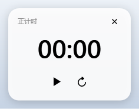
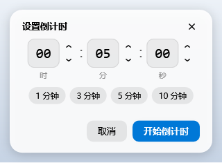

# BetterRNP 计时插件示例

这是一个完整的 `.rnpp` 示例插件，演示如何：

- 用 `RegisterFloatingBallCommand` 向悬浮球右键菜单添加命令；
- 从插件里创建无标题栏、强制置顶、半透明白色的 WPF 弹窗；
- 用矢量几何绘制按钮图标，不依赖字体图标或位图资源；
- 在 `OnUnload` 中关闭自己创建的窗口和计时器。

| 正计时（未开始） | 正计时（暂停后出现“重置”） |
|---|---|
|  |  |

| 倒计时最后 10 秒 | 时间选择 |
|---|---|
|  |  |

## 功能

右键悬浮球后，菜单中会出现 **正计时** 和 **倒计时** 两项（位于“随机抽取”之后、“悬浮球设置”之前）。

### 正计时

- 弹出小型半透明白色弹窗，无标题栏、强制置顶、可拖动。
- 时间文字为黑色，初始为 `00:00`。
- 下方是矢量绘制的“开始/暂停”按钮：
  - 未开始或暂停时显示三角“开始”图标；
  - 计时中显示双竖线“暂停”图标。
- 暂停后，按钮右侧出现矢量绘制的“重置”按钮，可把时间归零并回到未开始状态。
- 右上角有矢量“×”关闭按钮；卡片左上角显示“正计时”。

### 倒计时

1. 先弹出时间选择窗口：
   - 时、分、秒三个输入框可直接用键盘输入数字（只接受 0-9，失焦自动补零并夹到有效范围）；
   - 每个输入框右侧的上下箭头按钮可按 1 增减，输入框内按 ↑/↓ 也可以；
   - 提供 1 / 3 / 5 / 10 分钟常用时长按钮；
   - `Enter` 确认，`Esc` 取消；时长为 0 时提示“请输入大于 0 的倒计时时长”。
2. 确认后弹出与正计时完全相同的计时窗口，并自动开始倒计时。
3. 剩余时间 ≤ 10 秒时，时间文字变为红色。
4. 归零后停止计时并弹出“倒计时结束”消息框；窗口停留在 `00:00`，可点“重新开始”或“重置”。

### 计时窗口透明度

- 在 BetterRNP 的“设置 → 插件 → 计时插件设置”中调整。
- 正计时与倒计时共用同一个透明度滑块。
- 滑块为连续调整，不吸附刻度；拖动时立即应用到所有正在运行的计时窗口。
- 设置保存到 BetterRNP 注册表中的插件设置区域，下次启动继续使用。
- 计时窗口本身不再放置滑块，避免占用窗口空间。

## 安装

1. 构建插件，得到 `com.betterrnp.timer.rnpp`。
2. 在 BetterRNP 的“插件”→“插件管理…”中加载该文件，或直接放入程序目录的 `plugins\` 文件夹后重启。
3. 启用插件并显示悬浮球，右键悬浮球即可看到两项命令。

构建命令：

```bat
dotnet build examples\BetterRNP.TimerPlugin\BetterRNP.TimerPlugin.csproj -c Release
```

输出：

```text
examples\BetterRNP.TimerPlugin\bin\Release\net8.0-windows\com.betterrnp.timer.rnpp
```

## 代码结构

| 文件 | 说明 |
|---|---|
| `TimerPlugin.cs` | 插件入口：注册命令、复用/关闭窗口、卸载清理 |
| `Timing/TimerEngine.cs` | 与 UI 无关的计时状态机（空闲/运行/暂停/结束），可注入时钟以便测试 |
| `Views/TimerWindow.cs` | 正计时与倒计时共用的计时弹窗 |
| `Views/CountdownSetupWindow.cs` | 时间选择弹窗，含键盘输入、加减按钮与快捷键 |
| `Views/Ui.cs` | 半透明卡片、窗口样式、圆角按钮和矢量图标的公共工具 |
| `Views/Icons.cs` | 全部图标的矢量几何定义 |

计时窗口用 `Stopwatch` 累计时间、`DispatcherTimer` 每 100ms 刷新显示，因此窗口卡顿或拖动时不会让计时变慢。
倒计时剩余时间向上取整显示，开始时显示完整时长，归零时正好显示 `00:00`。

## 说明

- 窗口是独立的置顶窗口，不属于宿主主窗口；宿主退出或插件卸载时会关闭它们。
- 同一时间只保留一个正计时窗口和一个倒计时窗口：再次点击菜单会把已有窗口激活到最前；重新选择倒计时时长会替换旧的倒计时窗口。
- 弹窗只使用插件自己的样式，不依赖宿主主题资源，因此换主题时外观保持稳定。
